# TERRA NOVA — DESIGN_SPEC v1.3
Peradaban Bumi Baru · Chapter I — The Calling of Gaia · 25 November 2026

Status: [D] arah visual yang disetujui pemilik dalam percakapan; [R] rancangan implementasi; [U] target/parameter uji. Tidak mengesahkan D03–D14 atau membuka gate Fase 1. GAME_SPEC v0.6 tetap baseline mekanik; v0.7 memuat amendemen DWE untuk review. Bagian 13–16 memperinci DWE; bagian 17–18 menambahkan DLE (GAME_SPEC v0.8). Mockup bukan sumber angka ekonomi. Bila konflik, gunakan aturan induk yang disahkan dan catat keputusan.

## 1. Arah visual
[D] Gameplay sederhana, pixel art 2D isometrik bergaya 16-bit, satu lahan awal, jalan aspal melewati depan gerbang dan sungai di seberang jalan. Desktop dan mobile menampilkan dunia yang sama. UI hijau gelap minimalis. Referensi BosWarung.id sebatas kesederhanaan pengalaman; aset orisinal. [R] Ilustrasi fantasi hijau-emas untuk landing, prolog dan pemilihan karakter; gameplay memakai sprite ringan, bukan ilustrasi sinematik penuh.

## 2. Alur layar dan state
| Layar | Komposisi dan aksi | Persistensi |
|---|---|---|
| Landing | Gaia, logo, kontras krisis/masa depan, daftar/login; mobile hero ringkas lalu form | Auth; tidak memuat renderer |
| Prolog | Fakta dunia nyata → upaya global/lokal → Gaia memanggil → mulai perjalanan; lanjut, kembali, lewati, subtitle, mute | onboarding_step, intro_seen_at; replay tidak mengulang hadiah |
| Pilih karakter | Dua kartu pria/wanita, kemampuan sama; lanjut | pilihan avatar draft; bukan verifikasi usia |
| Buat profil | Pratinjau seluruh badan, nama karakter, rambut/warna, kacamata, topi, atasan, celana, sepatu, tas, aksesori; acak gaya | ID kosmetik tervalidasi, bukan gambar per kombinasi |
| Pilih kota | Negara/provinsi/kota-kabupaten manual, pencarian, peta ilustratif, profil sampah terverifikasi atau fallback | kode kota; tanpa GPS |
| Mulai misi | Ringkasan starter dan konfirmasi; kembali bila perlu | inisialisasi sekali oleh server |
| Pabrik | Lahan pribadi interaktif, HUD, dialog Gaia, misi | state ekonomi resmi; tutorial dapat dilanjutkan |
| Angkut/Pasar/Kota/Bumi | Panel atau rute terpisah, lazy load; fitur belum tersedia berlabel terkunci | izin dan fase dari server |

Nama profil contoh di mockup bukan default wajib. Angka statistik dan lokasi pada gambar bukan fakta terverifikasi. Gunakan sumber approved dengan tahun/cakupan; jangan mengklaim organisasi lingkungan tidak berdampak. Dialog awal tidak membocorkan twist Neraca Massa. Gaia berpakaian lengkap, memiliki agensi; konten sesuai arah 13+ dan review usia.

## 3. Layout starter [D/R]
Satu lahan berpagar kawat, gudang kecil, tempat pilah manual, area tumpukan, gerobak, avatar, pepohonan dan tanah. Gerbang benar-benar terhubung ke jalan aspal melalui jalur masuk. Sungai di seberang jalan memiliki tepi dan collision; tidak dapat diseberangi tanpa akses yang sah. Tidak ada excavator, truk, gedung dua lantai, mesin maju atau NPC pekerja yang dianggap milik pemain kecuali sudah dibuka oleh aturan. Referensi gambar boleh menampilkan benda dekoratif; jangan menganggapnya inventaris. Starter induk [U]: 10.000 Gaia Coin, 100 m², 1 gerobak, 1 gudang, 1 pemilahan, Awaken, Karma 0%; BHI dari snapshot, bukan 42% hardcoded. Tidak ada diamond atau energy bar baru.

[R/U] Grid logis awal 20×20, footprint lahan contoh 10×10 unit logis; pemetaan m² dan tile disahkan terpisah. Tile dasar 64×32 px (isometrik 2:1), sprite karakter 32×48 px, empat arah diagonal, 3–4 frame jalan, 1 frame diam. Koordinat grid independen dari piksel: screenX=(x−y)*tileW/2, screenY=(x+y)*tileH/2; inverse untuk hit-test, transform kamera dahulu. Anchor kaki objek; urutkan kedalaman berdasarkan posisi kaki/footprint dengan tie-break stabil. Gunakan overlay untuk atap/objek tinggi bila menutupi avatar. Tidak perlu 3D, fisika, pencahayaan real-time.

## 4. HUD dan interaksi
Atas: logo, avatar/nama, saldo, tier, Karma, poin Gaia bila ruang cukup, pengaturan. Bawah: Pabrik, Angkut, Pasar, Kota, Bumi. Panel misi dapat dilipat; BHI/ZWM diberi label cakupan dan waktu pembaruan. Dialog Gaia kontekstual. Desktop landscape: map dominan, panel samping opsional. Mobile portrait: header ringkas, map dominan, bottom sheet dan nav tetap; safe area, kontrol minimum 44 CSS px [U], teks tidak terpotong pada lebar 360 px; tanpa scroll horizontal. Keyboard/fokus, reduced motion, label ikon, kontras; daftar aksi alternatif tanpa harus berjalan atau drag.

Klik/tap gudang→inventaris, tempat pilah→aksi pilah, tumpukan→jenis/berat, gerobak→kontrak angkut, lahan→opsi pembangunan jika tersedia. Click/tap-to-move lokal [R], path grid sederhana, gerbang/collision; pan/zoom terbatas, pinch mobile. Tidak ada koordinat avatar dikirim tiap frame; posisi tidak menjadi otorisasi ekonomi. Server memvalidasi aksi/izin/kapasitas. Dialog aksi menampilkan input, biaya, output, kapasitas, konfirmasi, pending, receipt dan alasan gagal. Tidak ada perubahan saldo spekulatif yang terlihat sebagai hasil resmi. Offline jaringan: tampilkan snapshot terakhir dan status; jangan klaim aksi ekonomi berhasil tanpa receipt.

## 5. Tutorial hari pertama
Avatar di akses gerbang yang aman (bukan tengah jalan). Gaia: “Selamat datang. Dari tempat kecil inilah perjalananmu dimulai. Hilangkan sampahku.” Highlight satu objek/aksi: masuk → lihat lahan → pilih kontrak → ambil → pilah → olah atau jual → lihat saldo/neraca. Target tindakan bermakna ≤3 menit setelah onboarding; tidak ada forced wait. Skip dan resume, hadiah satu kali, pembaca layar dapat mengakses alternatif aksi. Kebun tidak menghalangi tutorial.

## 6. Kebun Gaia (D14, menunggu persetujuan)
Satu petak kecil di samping gudang di dalam lahan starter; bila flag off, tampil sebagai tanah biasa tanpa interaksi. Tidak ada halaman dunia pertanian, cuaca atau irigasi. Satu sprite tanah/tunas/matang dan kartu petak yang dibuka saat tap. State kosong → pilih benih → tumbuh → matang → panen; gudang penuh mempertahankan tanaman matang. UI menunjukkan waktu server, pilihan jual kompos atau pupuk, biaya peluang dan waktu panen baru sebelum konfirmasi. Nilai uji mengikuti KEBUN_GAIA.md: 2 kangkung+1 bayam, 4 jam/3 jam dengan 1 kg kompos sekali; tidak hardcode di UI. Benih langka: kartu misi dengan peluang dan koleksi tersisa, receipt hasil tetap pada retry; tanpa undian berbayar, tanpa keunggulan ekonomi. Tidak ada kredit lingkungan ganda. Tidak ada polling petak; timer visual dari snapshot dan aksi server. Arc IV tetap di luar scope.

## 7. Renderer dan aset [R/U]
Next.js/React/Tailwind untuk HUD; dynamic import renderer setelah masuk pabrik. Spike bandingkan Canvas 2D dengan PixiJS 2D; pilih satu berdasar profiling pada Android 2 GB. PixiJS kandidat utama untuk sprite, bukan kewajiban sebelum bukti; jangan memuat dua engine bersamaan. Layer: terrain, road/river, vegetation, buildings/fences, materials, avatar/vehicles, interaction overlay; depth sorting lintas objek yang saling menutupi. Cache layer statis, cull viewport; pooling hanya bila profil membuktikan manfaat. Nearest-neighbor, integer zoom bila memungkinkan, DPR Eco maksimal 1 [U], fallback statis/daftar aksi saat renderer gagal. Pause ticker/audio/poll saat tab tersembunyi; destroy scene, listener, texture yang tidak digunakan, pertahankan aset bersama dengan reference count.

Atlas awal maksimal dua 1024×1024 RGBA (8 MiB decoded total sebelum overhead); target texture GPU awal ≤16 MiB [U], ukur aktual termasuk render targets. PNG lossless/WebP lossless untuk pixel art; ilustrasi onboarding WebP/AVIF. Hindari screenshot sebagai map atau aset gameplay. Manifest ID, path, ukuran, anchor, footprint, frame, kategori, lisensi, hash, versi. Peta JSON berisi tile IDs, object IDs, grid/collision dan spawn, bukan gambar. Avatar layer body/hair/top/bottom/shoes/hat/glasses/bag/accessory dengan anchor, arah dan frame seragam; batasi layer terlihat; cache kombinasi aktif saja. Ilustrasi profil boleh berbeda dari sprite tetapi mengikuti pilihan ID. Aset dekoratif tidak menghasilkan uang/poin.

## 8. Anggaran dan acceptance
Ikuti PERFORMANCE_BUDGET.md: shell JS ≤250 KB compressed, aset pabrik ≤1 MB, total awal gameplay ≤3 MB; opening terpisah; heap ≤100 MB, target Eco 30 FPS, snapshot ≤20 KB, API p95 ≤500 ms. Ukur decoded/GPU/process memory terpisah; tidak mengklaim RAM dari ukuran download. Satu scene aktif; jangan preload seluruh onboarding, kota atau katalog. Uji Android 2 GB dan desktop, cold/warm, 30 menit soak, resize/orientation, background/resume dan fallback. Target bukan hasil benchmark.

## 9. Kontrak data dan integrasi
Usulan tambahan skema setelah approval: avatar_config per user (catalog IDs, palette IDs, version); cosmetic_catalog (slot, kompatibilitas, entitlement, asset ID); layout_template versioned; player_placements hanya jika pembangunan bebas disetujui (object ID, x/y, orientation, footprint, version). Fase 1 cukup template lokal deterministik, tidak perlu simpan posisi dekoratif/avatar per frame. Server cek ownership, overlap, bounds dan biaya jika placement berpengaruh ekonomi. Snapshot publik tidak memuat usia/gender privat. Simpan tutorial checkpoint di story_progress; katalog allowlist, jangan menerima URL aset dari pengguna. Tidak mengubah skema atau database pada Fase 0.

## 10. QA visual tambahan [P]
- Q20: screenshot desktop 1366×768 dan mobile 360×800/390×844; lahan yang sama, tidak crop gerbang/jalan/sungai tanpa cara pan, HUD terbaca, tidak overflow.
- Q21: hit-test tiap objek pada zoom/pan, collision pagar/sungai, depth sorting, fallback daftar aksi, sentuhan tidak memicu aksi ganda.
- Q22: seluruh slot avatar, dua karakter, kombinasi invalid ditolak, resume profil, hak kosmetik, tidak bocor data privat, tidak ada beda ekonomi.
- Q23: tutorial skip/resume/replay, jaringan putus, modal pending, receipt retry, starter tidak ganda, dialog tidak membocorkan twist.
- Q24: texture budget, 30 menit pindah scene, pause/resume, fallback renderer, tidak ada listener/texture leak; laporkan FPS dan memory trace nyata.
- Q25: kebun flag off/on, sprite sesuai status server, timer matang, gudang penuh, pilihan kompos, klaim langka retry, tanpa kredit ganda; Q19 tetap berlaku.

## 11. Urutan implementasi setelah gate disetujui
1. Spike visual satu scene dengan data fixture dan aset placeholder orisinal; bandingkan renderer dan ukuran.
2. HUD responsif, hit-test, tutorial dan interaksi lokal; sambungkan loop solo yang disetujui.
3. Onboarding, avatar dan kota manual; integrasikan persistence pada fase auth.
4. Kebun setelah loop solo stabil dan D14 disahkan; fitur kota/multiplayer sesuai roadmap.
5. Ganti aset final, QA, profiling dan review lisensi sebelum publikasi.

## 12. Referensi desain (gambar disisipkan langsung)
Folder references/ berisi mockup dari percakapan pemilik: landing desktop/mobile, walkthrough, pilihan karakter desktop/mobile, profil pria/wanita desktop/mobile, kota desktop/mobile, lahan jalan+sungai dan perbandingan desktop/mobile. Dua gambar terakhir adalah acuan utama gameplay. Gambar referensi hanya untuk developer, jangan disalin ke public runtime. Detail yang berbeda (saldo, tier, energi, gedung, alat, angka kota) tidak berlaku sebagai aturan. Layout dan ilustrasi masih harus diuji usability. Tidak ada aset produksi final dalam paket.


### UI-01 Landing
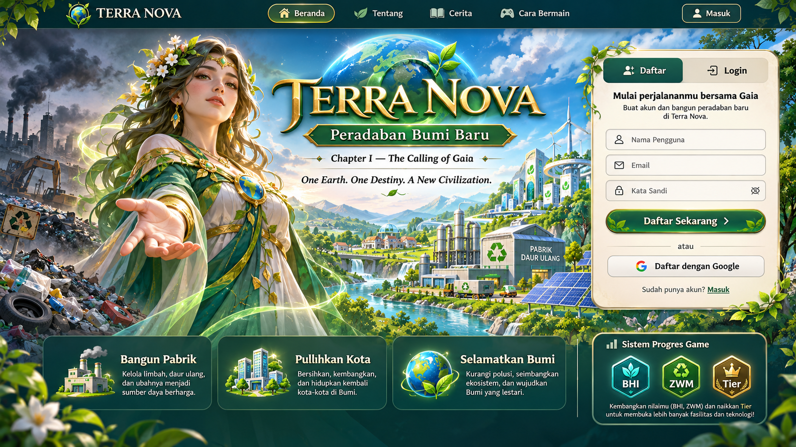

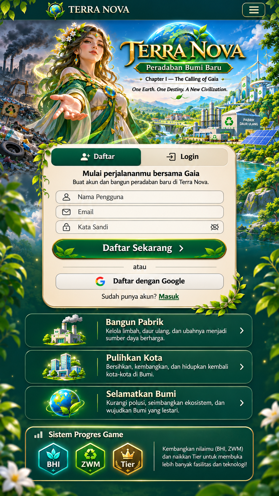


### UI-03 Walkthrough
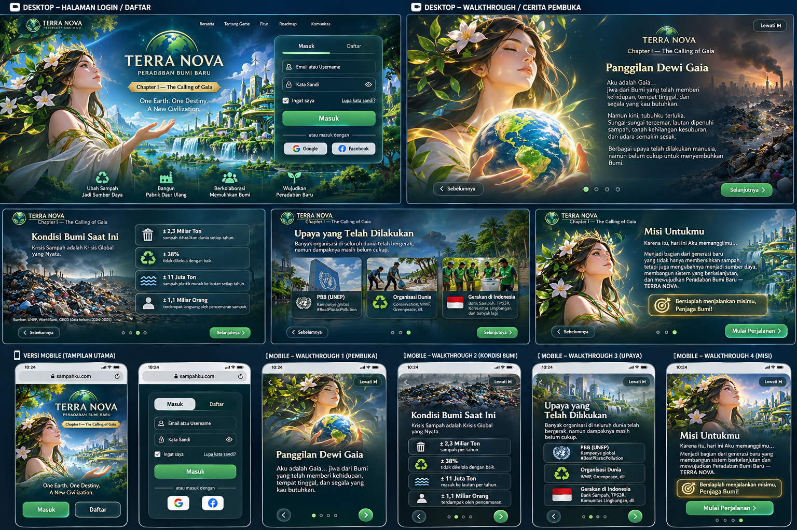


### UI-04 Pilih karakter
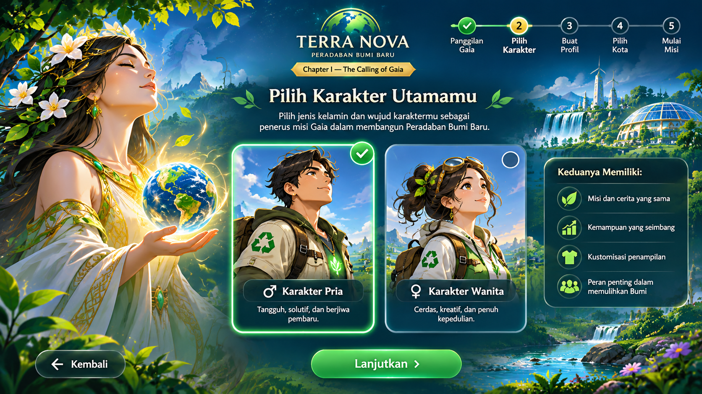

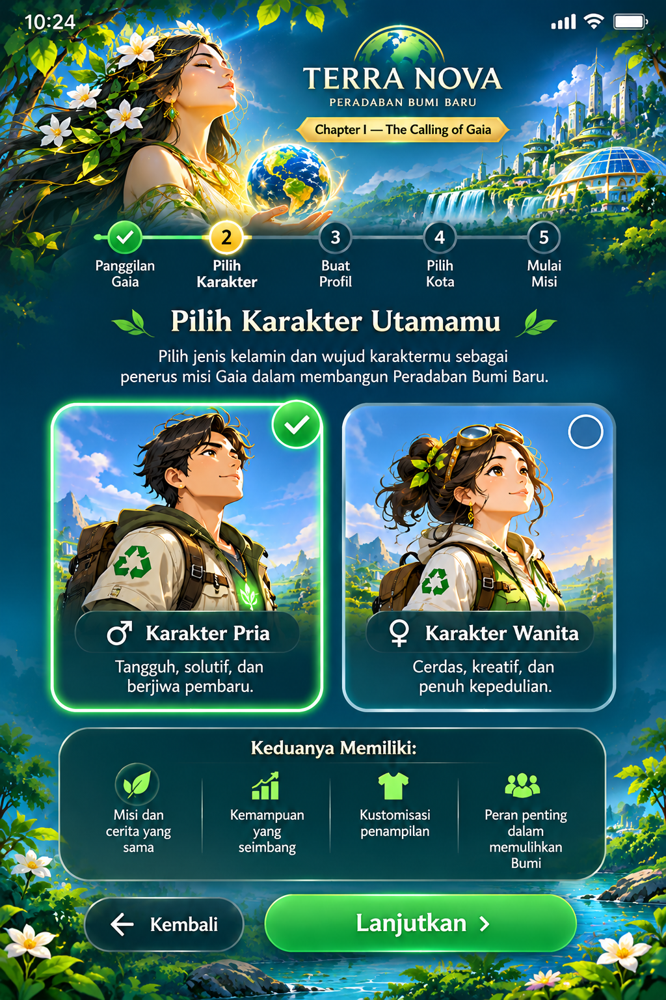


### UI-05 Profil pria
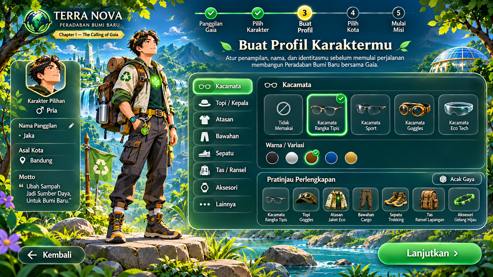

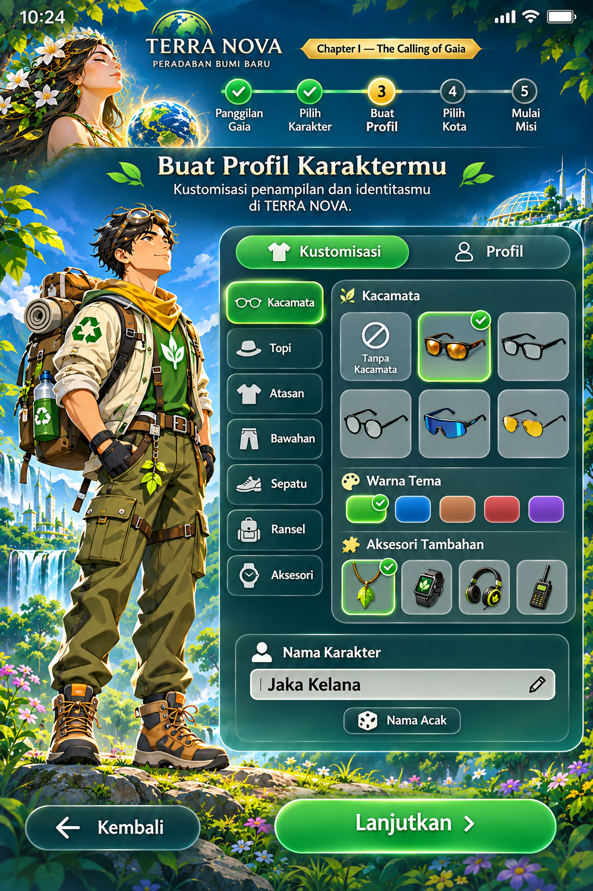


### UI-06 Profil wanita
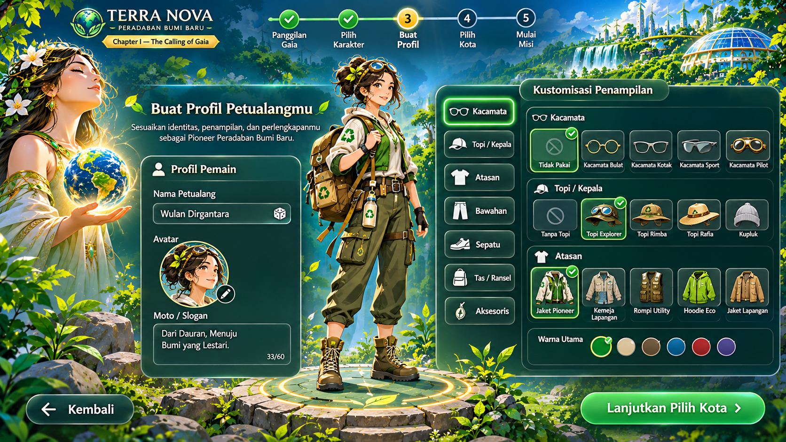

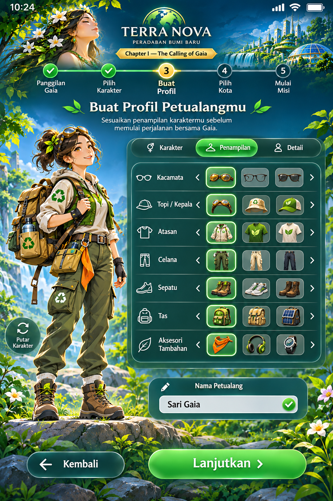


### UI-07 Pilih kota
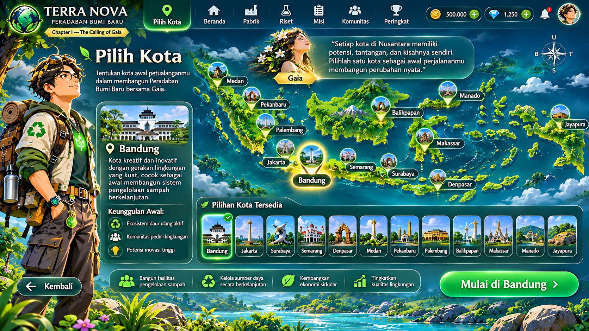

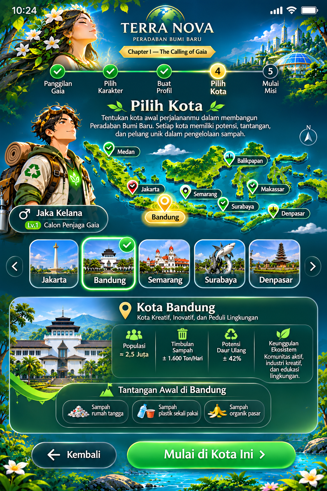


### UI-08 Gameplay referensi awal
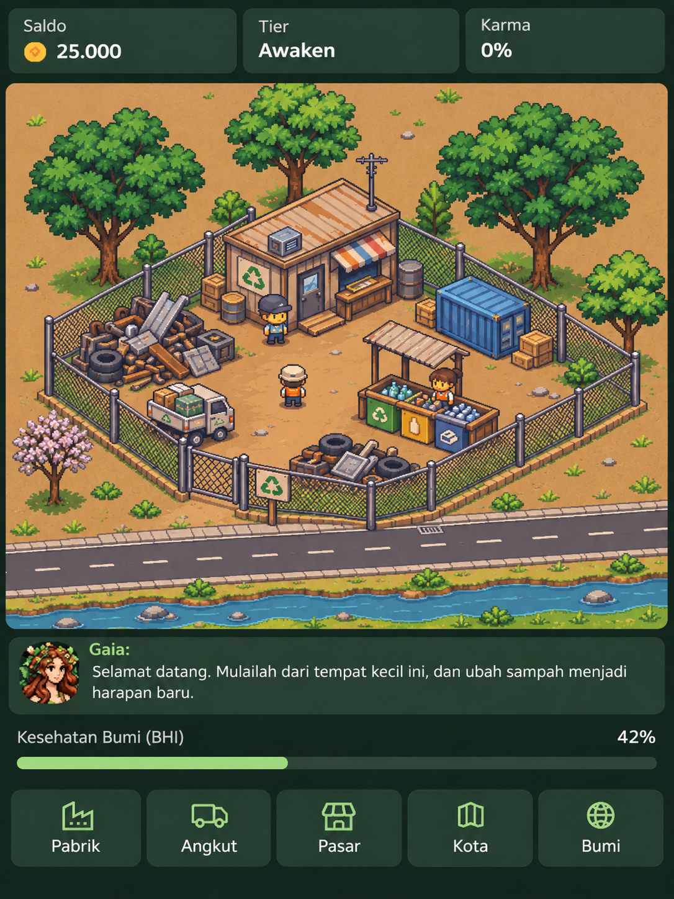

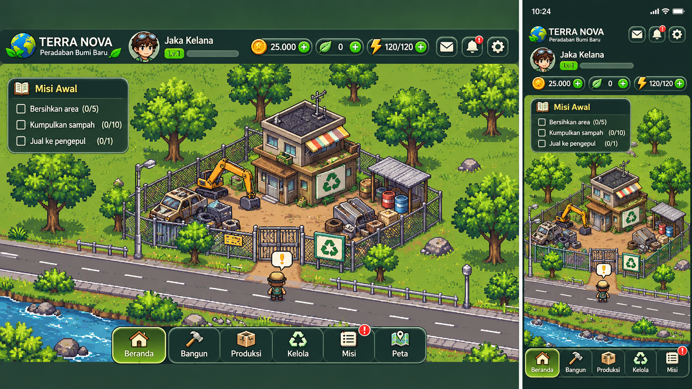


### UI-09 Denah awal dengan Kebun Gaia
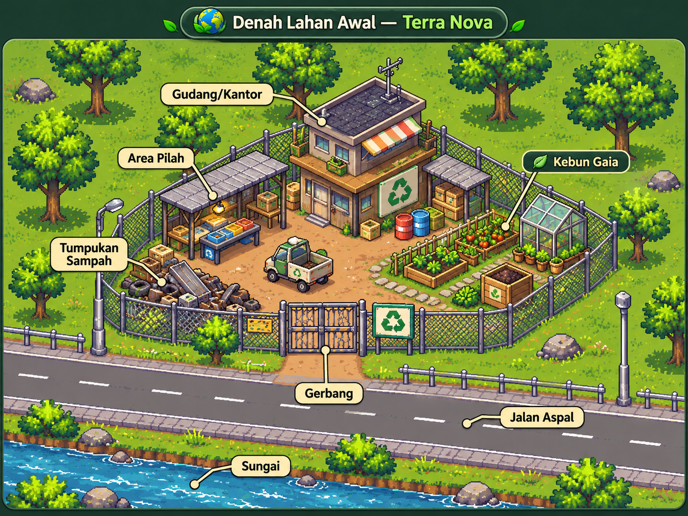


### UI-10 Denah upgrade tertinggi
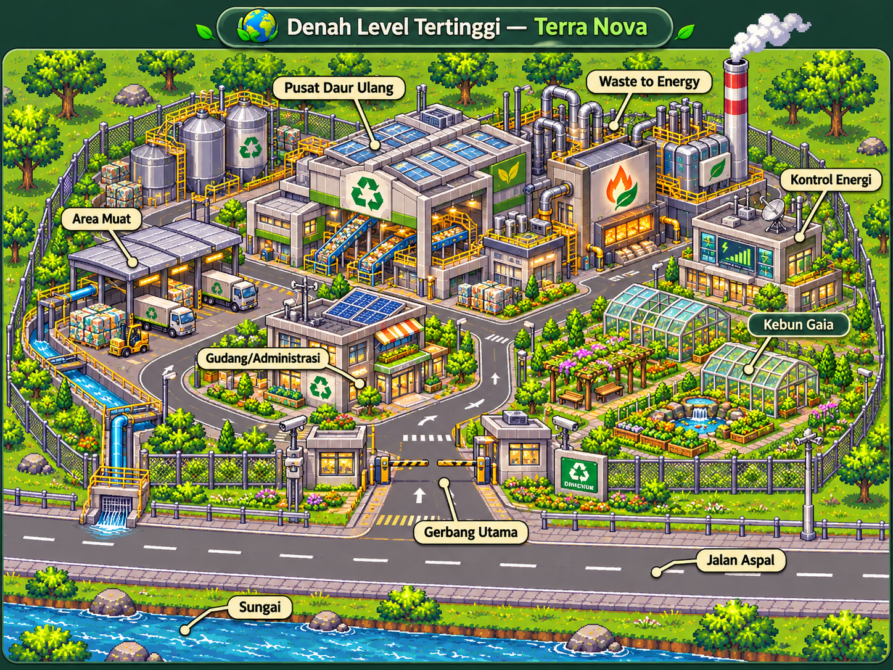

Denah UI-09/10 adalah acuan komposisi terkini; gambar lama UI-08 adalah acuan HUD dan pixel art, bukan layout final. Greenhouse, truk, excavator, saldo dan energy bar dalam gambar bukan entitlement starter. Kebun aktif hanya setelah D14 disahkan. Referensi level tertinggi bukan desain teknik sipil; saluran air pada ilustrasi perlu dikoreksi agar intake/return berada di bawah jalan, tidak mengalir ke jalan.

## 13. UI-11 — Angkut / peta sumber sampah (DWE) [R]
Belum tersedia mockup raster yang disetujui; wireframe berikut menjadi referensi struktural sementara, bukan pengganti gambar final.

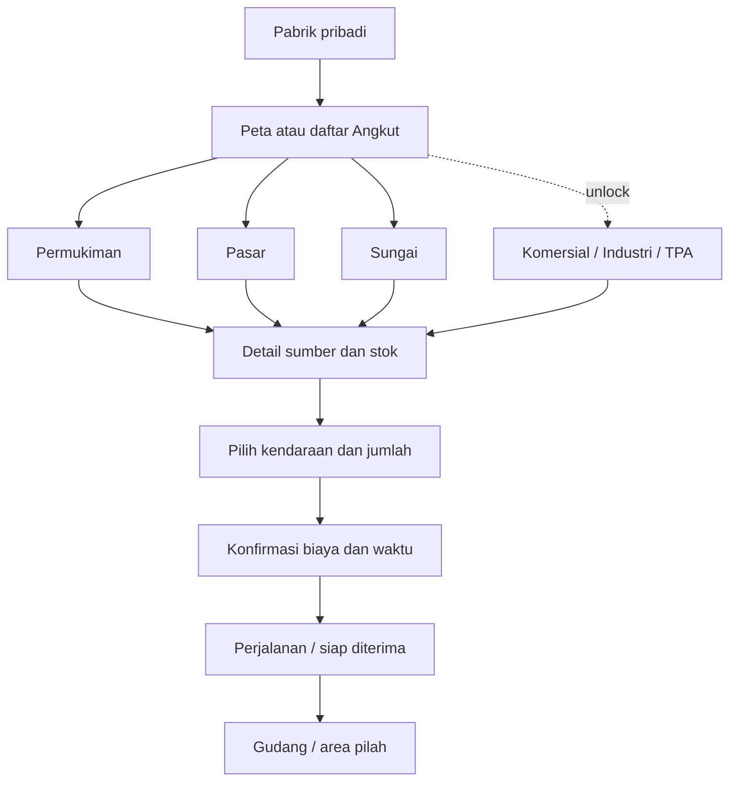
Desktop: map isometrik sederhana di tengah, daftar node/filter fraksi di kiri, detail/kontrak di kanan. Mobile: map di atas, daftar sumber dan detail melalui bottom sheet; tombol konfirmasi sticky dengan safe area. Opsi daftar selalu dapat digunakan tanpa map. Sumber terkunci tampil dengan syarat unlock, bukan tombol mati tanpa alasan. Ikon sumber: rumah, kios pasar, toko, gudang industri, sungai, TPA. Marker berisi stok tersedia, jenis dominan dan tanda event; jangan tampilkan stok total sebagai stok bebas. Peta kota adalah ilustrasi simulasi, bukan GPS atau peta real-time.

## 14. UI-12–15 — Alur angkut dan pengolahan [R]
| Layar | Desktop | Mobile | Informasi/aksi |
|---|---|---|---|
| Detail sumber | Panel kanan | Bottom sheet | Fraksi, stok bebas, kontaminasi, jarak, tarif, persyaratan |
| Kontrak | Dialog | Sheet penuh | Kendaraan, kg, kapasitas bebas gudang, biaya/imbalan, ETA PP, konfirmasi |
| Perjalanan | Kartu pekerjaan | Kartu ringkas | Reserved/in transit/arrived, countdown lokal, terima, alasan gagal |
| Gudang / pilah | Panel samping | Tab inventaris | Massa per fraksi, asal, kapasitas, pilih pilah/olah/jual |
| Neraca Massa | Panel diagram | Daftar aliran | Input, output, residu, emisi, transfer, satuan gram/kg; energi kWh terpisah |
| Pasar | Tabel pesanan | Kartu pesanan | Harga, kuota, stok, biaya peluang kompos, jual |

Tampilkan status jaringan, pending dan receipt resmi. Stok kosong menawarkan node lain; gudang penuh menawarkan pengosongan atau menunggu; reservasi gagal memperbarui stok. Jangan memunculkan klaim sukses dari animasi. Tidak perlu animasi seluruh rute: satu ikon kendaraan dan progress bar; posisi kosmetik lokal. Tutorial baru: Gaia menunjuk gerbang → Angkut → pilih pasar/permukiman → gerobak → terima → pilah → jual; Kebun Gaia menjadi misi lanjutan.

## 15. UI-16–18 — Evolusi lahan dan ekosistem [R]
Satu world template dengan anchor permanen gerbang, jalan aspal dan sungai. Lahan berkembang ke belakang/samping, bukan menggeser sungai/jalan. Tahap 1 gudang, pilah, gerobak, satu petak kebun (jika D14 aktif); tahap 2 bank sampah; tahap 3 mesin; tahap 4 fasilitas terpadu; tahap 5 kompleks canggih dengan jalur WtE pilihan, solar, kontrol energi, kebun berkembang, intake/return mikrohidro opsional. Jalan dan sungai tetap pada koordinat world yang sama meski kamera zoom out. WtE dan mikrohidro diberi label terpisah. Jangan memberi kesan sungai adalah bahan bakar sampah.
Sungai visual: bersih/sedang/tercemar dari status node, dekorasi sampah dibatasi dan tidak sama dengan jumlah kg. Kebun: tanah/tunas/matang, kartu aksi D14; pabrik: idle/working/blocked; event: ikon kecil dan perubahan stok, bukan scene baru. BHI/ZWM pribadi/kota/global diberi label cakupan dan waktu snapshot. Panel pencegahan menampilkan penurunan timbulan simulasi, tidak mengklaim dampak nyata.

## 16. Asset dan acceptance DWE [R/U]
Tambah ID sprite reusable: source_house, source_market, source_commercial, source_industry, source_river, source_landfill, waste_pile_small/medium/large, cart, tricycle, pickup, truck, garden_soil/sprout/mature, hydro_intake/return, wte_module. Gunakan satu atlas aktif per scene sesuai §7; tidak memuat seluruh kota saat bermain pabrik. Gambar referensi Markdown tidak masuk public/runtime. Mockup raster Angkut, kontrak, inventaris, pasar, neraca, upgrade intermediate, Bumi Global masih perlu dibuat/review; jangan menyatakan lengkap.
QA: desktop 1366×768 dan mobile 360×800/390×844, node dan data sama, menu list fallback, tap target 44px, keyboard/reduced motion, tidak ada crop yang tidak bisa dipan, stok dan job sesuai receipt, refresh tidak menduplikasi aksi, pergantian scene melepas aset, tidak ada polling tiap objek, 30 FPS Eco dan anggaran §8 tetap. Uji visual starter dan max anchor sungai/jalan identik. Tidak mengubah gate Fase 0.


## 17. UI-19 — Jalan dan sungai hidup (DLE) [D/R/U]
### Referensi komposisi dasar yang disetujui


Gambar tersebut adalah acuan posisi permanen; belum menggambarkan event DLE. Gunakan wireframe berikut untuk overlay aktivitas, bukan mockup raster final.

```text
  [Gudang] [Area Pilah] [Kebun Gaia]
  ───────── Pagar ── Gerbang ────────
           Avatar / akses aman
  Trotoar      [!] Sayuran tercecer
  ===== jalan aspal: NPC / mobil → =====
  Tepi aman   NPC [!]       titik ambil
  ~~~~~~~~~ sungai: botol/kaleng ~~~~~~~
```
Jalan dan sungai tidak berpindah saat upgrade. Kendaraan melewati jalur tetap, NPC berjalan pada bahu jalan/trotoar, sebagian menuju tepi sungai. Animasi singkat memperlihatkan NPC membuang kemasan atau mobil sayur menjatuhkan muatan; setelah itu sprite sampah muncul pada anchor sah. Tidak ada objek sampah di tengah lajur yang harus didatangi pemain; gunakan titik interaksi bahu jalan dan tepi sungai, bukan masuk air. NPC dan mobil terus berlalu tanpa menghalangi akses gerbang. Jangan menambah jalan, jembatan, atau area baru hanya untuk event.

Desktop: peta dominan, ikon tanda seru di atas sampah, hover/fokus menampilkan jenis dan perkiraan berat, klik membuka kartu “Bersihkan”; panel misi samping menampilkan tugas aktif. Mobile: tap target minimum 44 CSS px, bottom sheet ringkas jenis/berat/kapasitas, tombol “Ambil sampah”; daftar misi juga bisa digunakan tanpa tap sprite kecil. Kedua tampilan menggunakan state/anchor/event ID yang sama. Jika belum ada event, jalan tetap hidup secara kosmetik dan panel tidak menutup peta. Jika penuh, pesan “Gudang penuh — kosongkan ruang terlebih dahulu”; jangan menghilangkan sprite sebelum receipt resmi. Jika expired, ikon hilang/berubah ke status backlog; jangan menampilkan hadiah palsu.

### Storyboard mikrointeraksi
1. NPC lewat normal / mobil sayur lewat dari sisi layar.
2. Untuk event sah, animasi lempar/jatuh singkat; sprite botol atau sayur muncul di anchor.
3. Ikon tanda seru dan pesan Gaia: “Bersihkan sampah di depan gerbangmu.”
4. Pemain tap/klik atau pilih misi; preview gram dan kapasitas; konfirmasi.
5. Avatar berjalan ke titik aman secara kosmetik; server klaim dan receipt; sprite dihapus setelah sukses; toast “+ material ke inventaris”.
6. Material muncul di area pilah; pemain menentukan resep. Tidak langsung berubah menjadi kompos.
Reduced motion: tampilkan perubahan state tanpa animasi lempar/berjalan. Tidak menggunakan suara wajib atau efek partikel berat.

## 18. Asset, rendering dan acceptance DLE [R/U]
| Asset ID | Keterangan |
|---|---|
| npc_pedestrian_walk | Reuse base sprite, 4 arah, 3–4 frame |
| npc_litter_pose | 1–2 frame tambahan atau pose statis |
| vehicle_vegetable_pickup | Sprite kendaraan dan muatan, reusable |
| waste_pet_river / waste_can_river | Sprite kecil di tepi sungai |
| waste_vegetable_spill | Sayur jatuh, 2–3 variasi visual |
| quest_cleanup_marker | Ikon tanda seru reusable |
Usulan cap awal 4 NPC + 2 kendaraan + 3 insiden terlihat sekaligus; pooling, fixed waypoint, culling, depth sort dengan anchor kaki, nearest-neighbor, atlas scene, tanpa physics engine. Animasi lokal berhenti saat tab tersembunyi; satu scheduler renderer, tanpa timer terpisah per sprite. Jangan memuat atlas kota/intro. Jangan mengubah ukuran unduhan awal ≤3 MB, JS heap ≤100 MB, target 30 FPS Eco; ukur juga memori tekstur/GPU dan stabilitas 30 menit. Aset referensi bukan runtime. Angka cap merupakan target profiling, bukan benchmark.
Acceptance: desktop/mobile sama-sama melihat event sah; avatar tidak menembus pagar/sungai; akses jalan dan gerbang tetap; NPC biasa tidak selalu membuang; pickup sukses menambah inventaris satu kali, kegagalan tidak memberi bonus; refresh/reconnect/dua tab konsisten; reduced motion dan keyboard/list fallback bekerja; upgrade awal→akhir menjaga anchor; tidak ada traffic server per frame. Mockup raster aktivitas NPC/mobil belum dibuat, sehingga referensi dasar + wireframe ini tidak dianggap persetujuan visual final. D20 disetujui arah fitur; D21 parameter menunggu review Fase 0.
